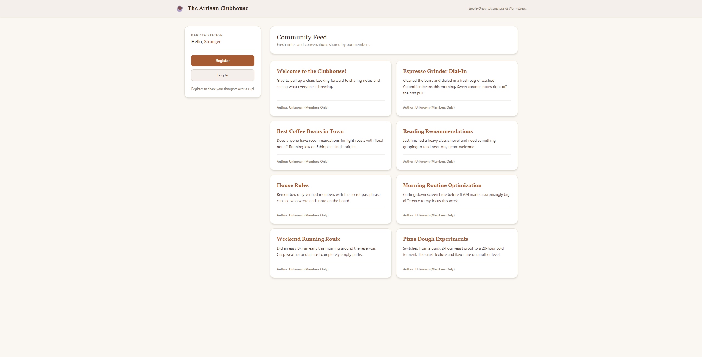
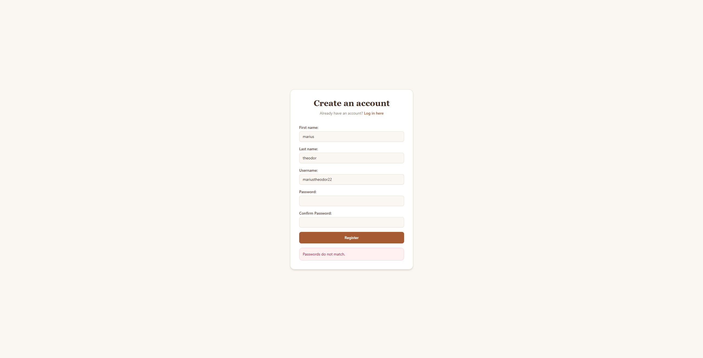
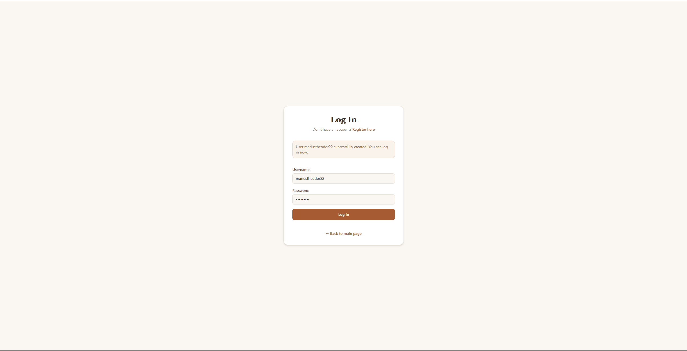
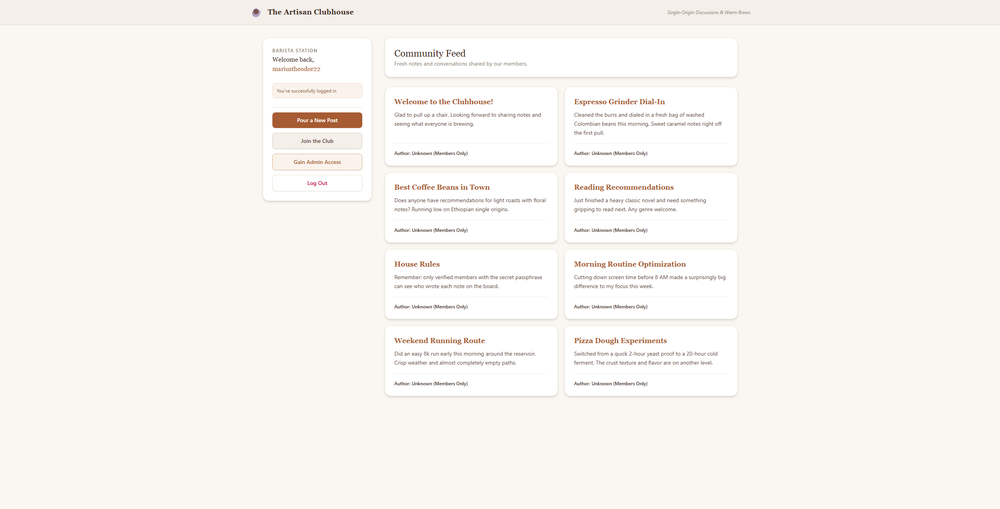
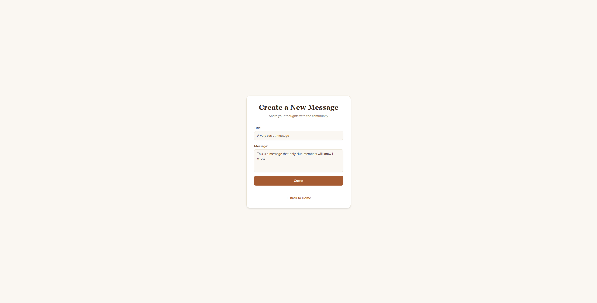
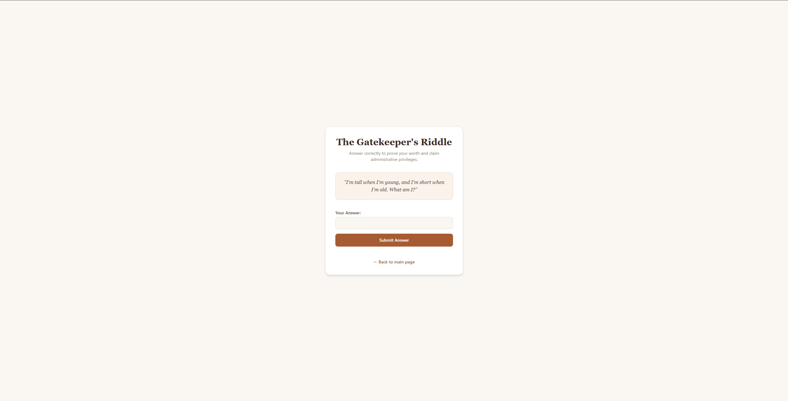

# Members Only - Exclusive Clubhouse

A secure, full-stack message board web application where users can register accounts, log in via Passport.js, unlock club membership using a secret passcode, and view or post anonymous messages based on permission levels. An administrative tier allows designated users to moderate and delete posts.

**Live Demo:** [https://members-only-vuz4.onrender.com](https://members-only-vuz4.onrender.com)

---

## App Screenshots

<p align="center">
  
  
  <br>
  
  
  <br>
  
  
</p>

---

## Tech Stack & Architecture

- **Frontend:** EJS (Embedded JS Templates)
- **Backend:** Node.js, Express.js, Express-Session, Passport.js (Local Strategy), Connect-Flash
- **Database & Security:** PostgreSQL (Neon Cloud), `pg`, bcrypt, Helmet, Express-Validator
- **Deployment & Tooling:** Render, Git, ESLint, Prettier

---

## Key Features

- **Authentication & Authorization:** Salted password hashing via `bcrypt` and session persistence using `passport-local` and `connect-pg-simple`.
- **Role-Based Access Control:**
  - **Guests:** View all messages anonymously with author details and timestamps hidden.
  - **Members:** Create new posts and unlock author attribution and timestamps by entering a secret passcode.
  - **Administrators:** View full details and delete messages.
- **Input Validation:** Backend validation and sanitization using `express-validator` including password confirmation matching.

---

## Local Installation & Setup

1. Clone the repository:

   ```bash
   git clone https://github.com/sadwipe/members-only.git
   cd members-only
   ```

2. Install dependencies:

   ```bash
   npm install
   ```

3. Create a `.env` file in the root directory:

   ```env
   PORT=3000
   DB_URL=your_postgresql_connection_string
   SESSION_SECRET=your_session_secret
   SECRET_PASSCODE=your_club_passcode
   ADMIN_PASSWORD=your_admin_passcode
   ```

4. Seed the database:

   ```bash
   npm run seed
   ```

5. Start the development server:
   ```bash
   npm run dev
   ```
